### Hi there. Welcome to my photoblog.

I'm *Ann*. I like to take photos, and write about random things.

I love cats and dogs.

This is <i>Seven</i>. He is loyal, loving, and protective, but also naughty, throws tantrums, and eats just about anything and everything.

  
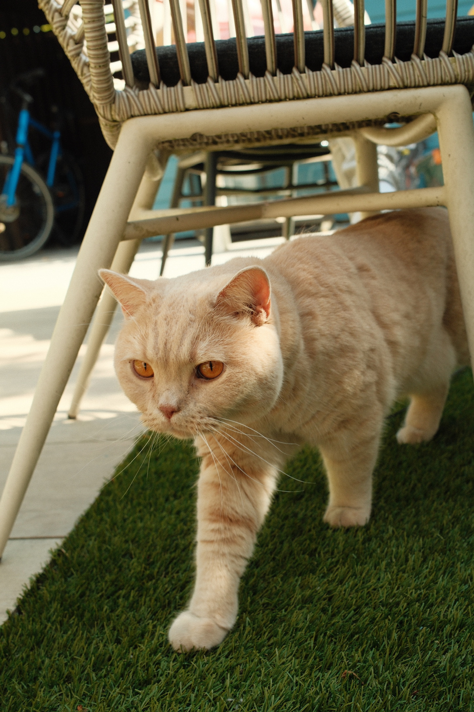

  
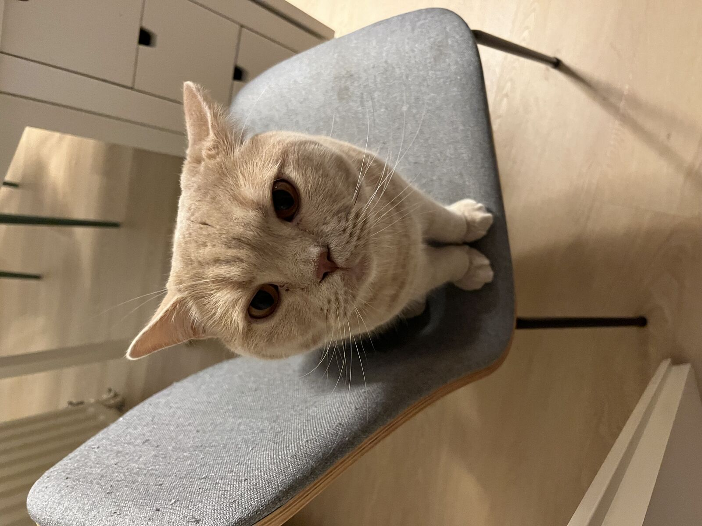

  
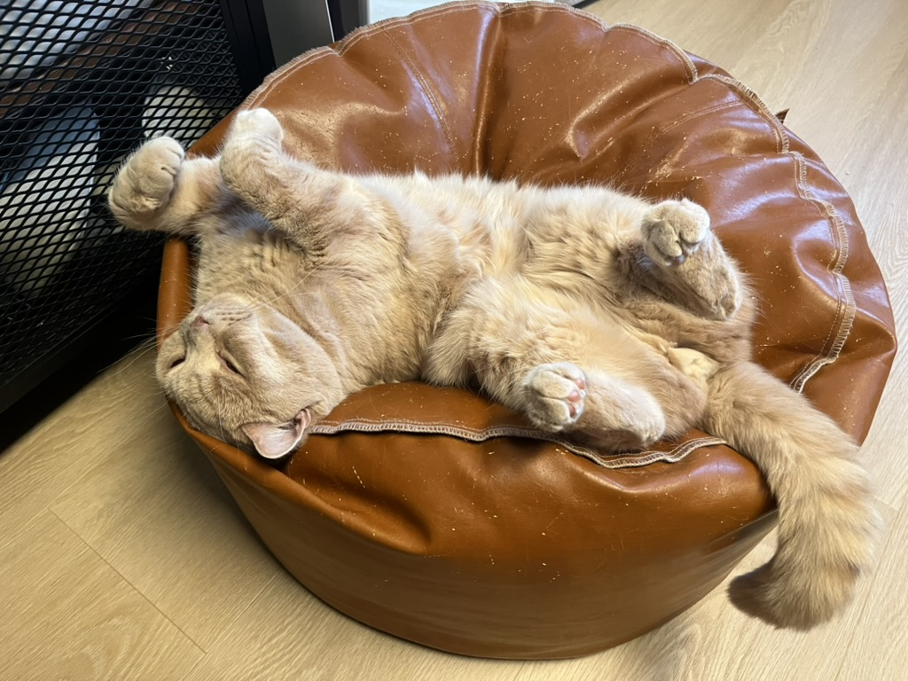

  
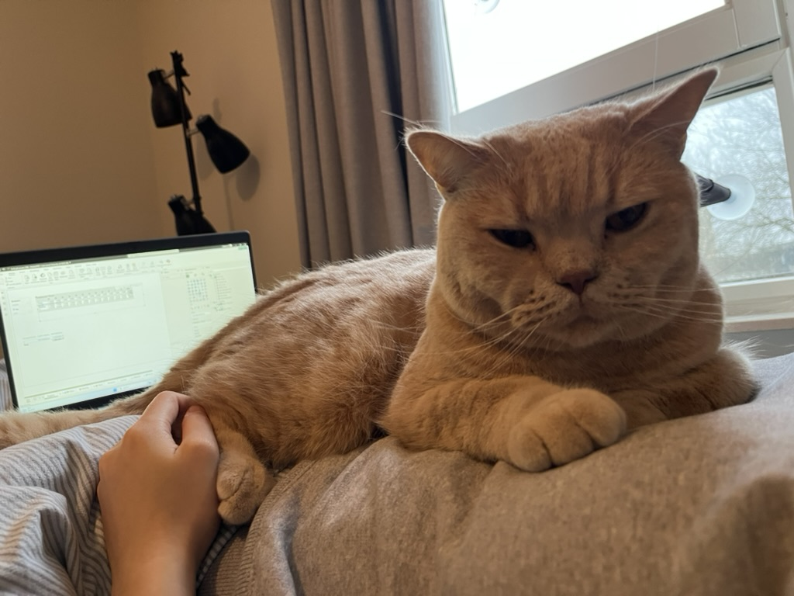

This is <i>Eleven</i>. He is the little brother of Seven. He is an independent, free-spirited soul who is warm, sensitive and lives by habits.

  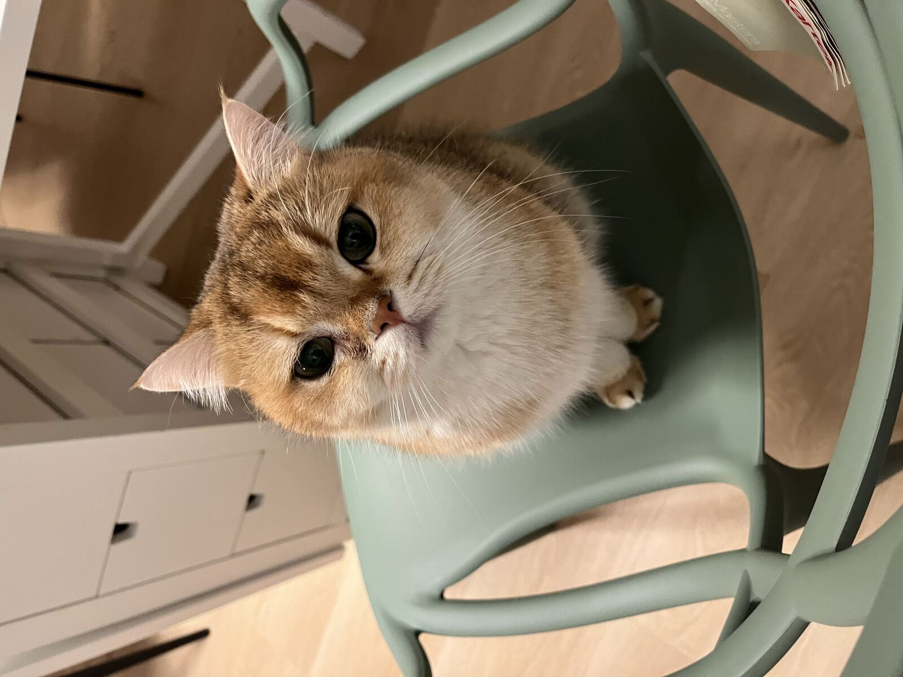
  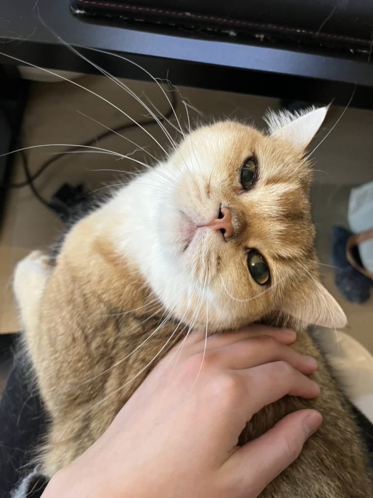
  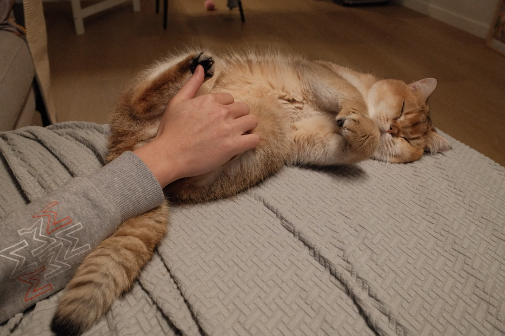
  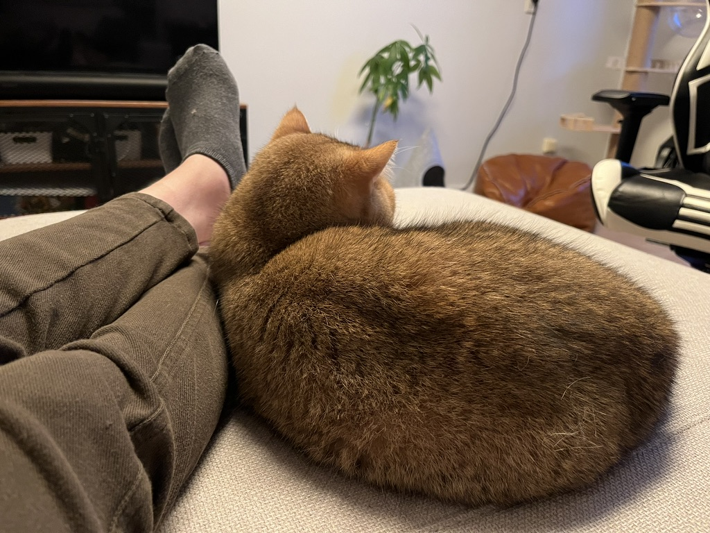

Eleven loves his big brother Seven so much. But Seven acts tough and does not reciprocate Eleven's love for him. Together they make us happy.

  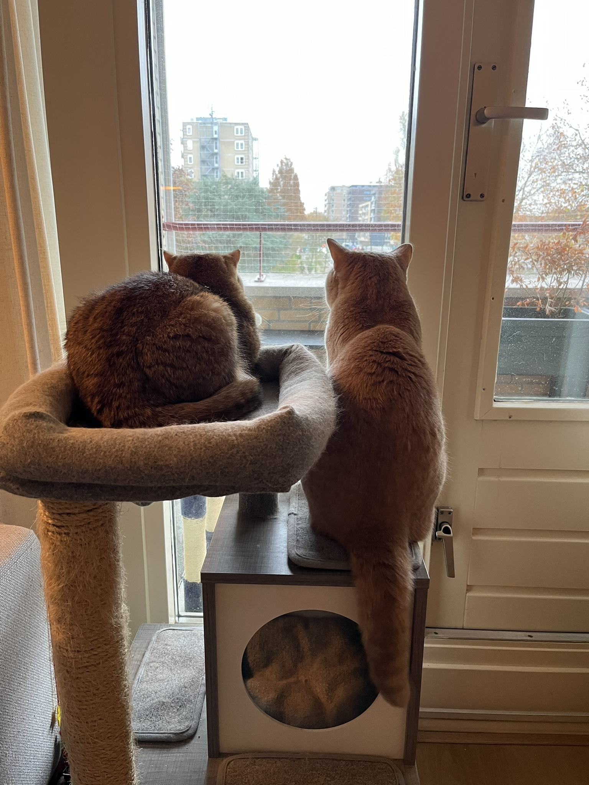

Back home, my family also own a mountain dog called (left). She is about a year old, very energetic, attention-seeking but also insecure at times. And in lovig memory, on the right is Oma who passed in February 2025 at the age of 13 due to cancer.

  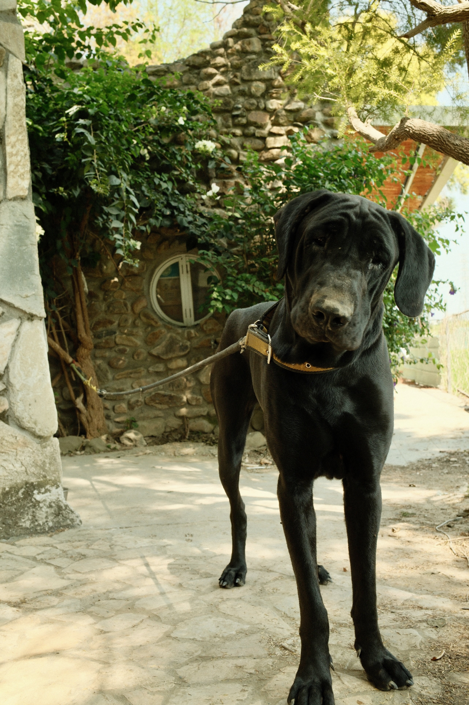
  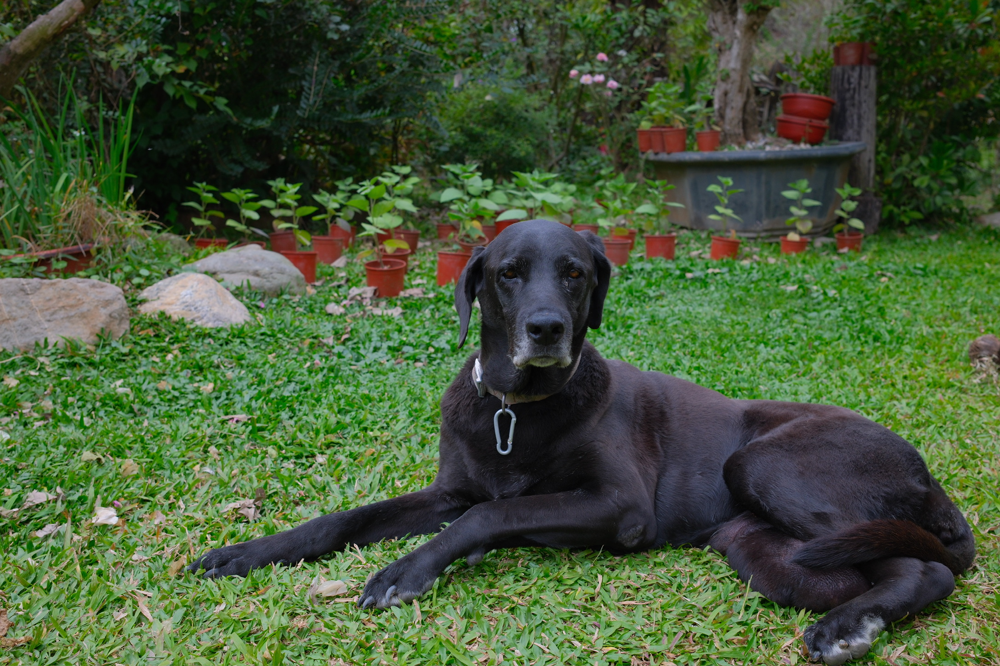

<!--  

  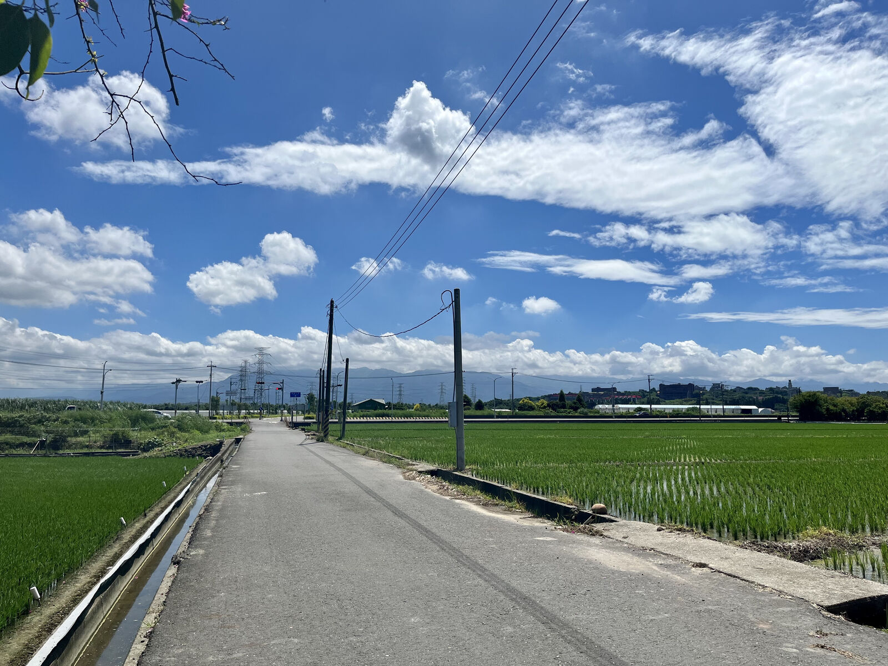
  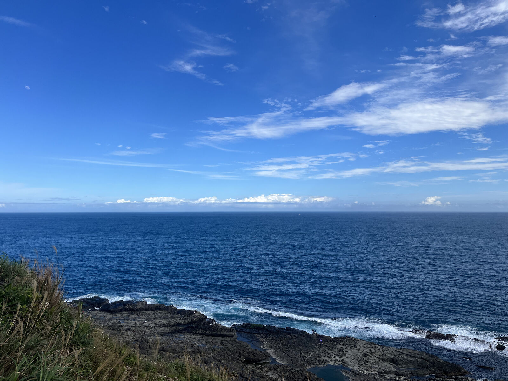
  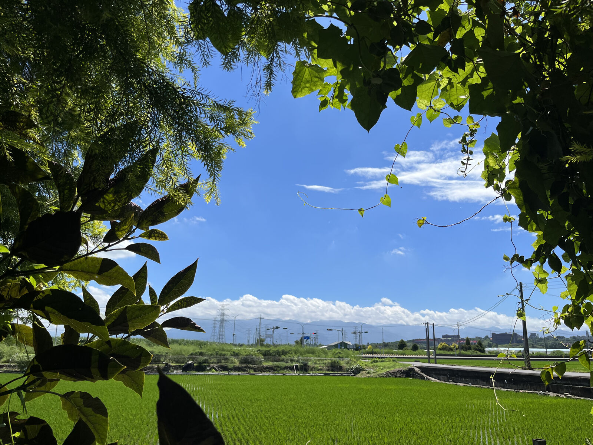

 -->